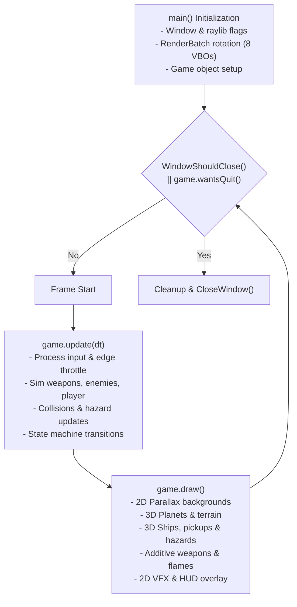

# Architecture Overview

This document details the code architecture of U11 Starfighter, explaining how the main source files, game loop, rendering pipelines, combat mechanics, and audio systems fit together.

---

## 1. Source File Organization

| File(s) | Primary Purpose |
|---|---|
| **Core & Application** | |
| [main.cpp](file:///C:/Users/Administrator/Desktop/u11-docs/main.cpp) | Application entry point. Configures window flags, working directory, FPS limiter, rlgl render batch buffer rotation, and drives the main loop. |
| [config.hpp](file:///C:/Users/Administrator/Desktop/u11-docs/config.hpp) | Global design-space tunables (speeds, bounding sizes, flame properties, weapon parameters, shake limits, and quality constants). |
| [game.hpp](file:///C:/Users/Administrator/Desktop/u11-docs/game.hpp) / [game.cpp](file:///C:/Users/Administrator/Desktop/u11-docs/game.cpp) | Central coordinator. Houses the high-level state machine, campaign flow, level loading, collision resolution, entity updates, and save-game persistence. |
| [view.hpp](file:///C:/Users/Administrator/Desktop/u11-docs/view.hpp) | Coordinates playfield geometry, projection transformations (screen vs. playfield-local space), camera modes (`SideScroll` vs. `TopDown`), and dynamic resolution scaling `s`. |
| [profile.hpp](file:///C:/Users/Administrator/Desktop/u11-docs/profile.hpp) / [profile.cpp](file:///C:/Users/Administrator/Desktop/u11-docs/profile.cpp) | Lightweight frame profiling instrumenting CPU and GPU execution stages (`PROFILE=1` or `PROFILE=2`). |
| **Rendering & VFX** | |
| [render3d.hpp](file:///C:/Users/Administrator/Desktop/u11-docs/render3d.hpp) / [render3d.cpp](file:///C:/Users/Administrator/Desktop/u11-docs/render3d.cpp) | Real-time 3D rendering engine. Manages GLB models, shaders, dynamic hull vertex-dent displacements, breakup debris, 3D shield sphere arcs, volumetric atmosphere/clouds, and sun directional lighting. |
| [background.hpp](file:///C:/Users/Administrator/Desktop/u11-docs/background.hpp) / [background.cpp](file:///C:/Users/Administrator/Desktop/u11-docs/background.cpp) | Multi-layered parallax background system (stars, procedural nebulae, asteroid fields, textured image layers, and 3D planet hooks). |
| [planet_terrain.hpp](file:///C:/Users/Administrator/Desktop/u11-docs/planet_terrain.hpp) / [planet_terrain.cpp](file:///C:/Users/Administrator/Desktop/u11-docs/planet_terrain.cpp) | Procedural chunked planetary terrain elevation generator used in Planetfall, Fortress Approach, and Liftoff. |
| [planet_render.hpp](file:///C:/Users/Administrator/Desktop/u11-docs/planet_render.hpp) / [planet_render.cpp](file:///C:/Users/Administrator/Desktop/u11-docs/planet_render.cpp) | Renders planetary terrain chunks with level-of-detail meshes, surface shading, and ground features. |
| [vfx.hpp](file:///C:/Users/Administrator/Desktop/u11-docs/vfx.hpp) / [vfx.cpp](file:///C:/Users/Administrator/Desktop/u11-docs/vfx.cpp) | 2D/3D billboard particle visual effects loaded from JSON configurations (`assets/fx/`). Handles explosion bursts, smoke, and contact impacts. |
| [particles.hpp](file:///C:/Users/Administrator/Desktop/u11-docs/particles.hpp) / [particles.cpp](file:///C:/Users/Administrator/Desktop/u11-docs/particles.cpp) | High-performance particle pools for procedural engine exhaust flames, nozzle glitter, and sparks. |
| **Physics & Transforms** | |
| [world_position.hpp](file:///C:/Users/Administrator/Desktop/u11-docs/world_position.hpp) | Unified 3D world coordinate frame (X forward, Y lateral, Z height) and projection mapping to local view modes. |
| [world_physics.hpp](file:///C:/Users/Administrator/Desktop/u11-docs/world_physics.hpp) / [world_physics.cpp](file:///C:/Users/Administrator/Desktop/u11-docs/world_physics.cpp) | 3D bounding geometry, capsules, and swept contact testing. |
| [ship_physics.hpp](file:///C:/Users/Administrator/Desktop/u11-docs/ship_physics.hpp) / [ship_physics.cpp](file:///C:/Users/Administrator/Desktop/u11-docs/ship_physics.cpp) | Ship inertia, pitch, and roll banking kinematics. |
| [camera_system.hpp](file:///C:/Users/Administrator/Desktop/u11-docs/camera_system.hpp) / [camera_system.cpp](file:///C:/Users/Administrator/Desktop/u11-docs/camera_system.cpp) | Camera basis orientations, view transformations, and chase camera math. |
| **Entities, Ships & Combat** | |
| [player.hpp](file:///C:/Users/Administrator/Desktop/u11-docs/player.hpp) / [player.cpp](file:///C:/Users/Administrator/Desktop/u11-docs/player.cpp) | Player flight state, input interpretation, floating touch joystick math, edge throttle detection, and speed clamping. |
| [ship.hpp](file:///C:/Users/Administrator/Desktop/u11-docs/ship.hpp) | Base ship class defining common health, position, and velocity fields. |
| [enemies.hpp](file:///C:/Users/Administrator/Desktop/u11-docs/enemies.hpp) / [enemies.cpp](file:///C:/Users/Administrator/Desktop/u11-docs/enemies.cpp) | Enemy instance pool, movement patterns (straight, sine, dive, circle, path waypoints, invaders marching grid, boss strafe), firing timers, and Warden boss logic. |
| [weapons.hpp](file:///C:/Users/Administrator/Desktop/u11-docs/weapons.hpp) / [weapons.cpp](file:///C:/Users/Administrator/Desktop/u11-docs/weapons.cpp) | Primary weapons (Laser, Flamethrower, Plasma Lance) and secondary homing missiles. Manages heat buildup, overheat cooldowns, projectile pools, and beam raycasts. |
| [projectile.hpp](file:///C:/Users/Administrator/Desktop/u11-docs/projectile.hpp) | Projectile data structures and pooling for laser bolts, missiles, and enemy shots. |
| [combat_types.hpp](file:///C:/Users/Administrator/Desktop/u11-docs/combat_types.hpp) | Faction allegiance, projectile ownership, and target profile classifications. |
| [turret.hpp](file:///C:/Users/Administrator/Desktop/u11-docs/turret.hpp) | Articulated defense turret: target tracking, barrel rotation, recoil animation, and destructible wreckage. |
| [bulkhead.hpp](file:///C:/Users/Administrator/Desktop/u11-docs/bulkhead.hpp) / [bulkhead.cpp](file:///C:/Users/Administrator/Desktop/u11-docs/bulkhead.cpp) | Animated security bulkhead doors in Level 3 with collision capsules and pillar fading. |
| **Specific Level Handlers** | |
| [moon_level.hpp](file:///C:/Users/Administrator/Desktop/u11-docs/moon_level.hpp) / [moon_level.cpp](file:///C:/Users/Administrator/Desktop/u11-docs/moon_level.cpp) | Level 8 manager: orbit approach, asteroid collision, moon fracture shaders, and integration with the trench run. |
| [trench_run.hpp](file:///C:/Users/Administrator/Desktop/u11-docs/trench_run.hpp) / [trench_run.cpp](file:///C:/Users/Administrator/Desktop/u11-docs/trench_run.cpp) | Level 8 3D trench run: 3D corridor geometry, surface plating, wall turrets, chasing fighters, bombing the exhaust port, and catastrophic escape. |
| **Data, UI & Audio** | |
| [data.hpp](file:///C:/Users/Administrator/Desktop/u11-docs/data.hpp) / [data.cpp](file:///C:/Users/Administrator/Desktop/u11-docs/data.cpp) | JSON parser and database for levels, enemies, players, campaign steps, and drop tables. |
| [assets.hpp](file:///C:/Users/Administrator/Desktop/u11-docs/assets.hpp) / [assets.cpp](file:///C:/Users/Administrator/Desktop/u11-docs/assets.cpp) | Asset loader and cache (textures, fonts, shaders, models). |
| [cutscene.hpp](file:///C:/Users/Administrator/Desktop/u11-docs/cutscene.hpp) / [cutscene.cpp](file:///C:/Users/Administrator/Desktop/u11-docs/cutscene.cpp) | Cutscene sequencer: step-based dialog, speaker portraits, actor movements, fades, and camera shake. |
| [menus.cpp](file:///C:/Users/Administrator/Desktop/u11-docs/menus.cpp) / [title.cpp](file:///C:/Users/Administrator/Desktop/u11-docs/title.cpp) | Title screen 3D flyby, Level Select, Options, Development tuning, Pause overlay, and Victory screens. |
| [ui_theme.hpp](file:///C:/Users/Administrator/Desktop/u11-docs/ui_theme.hpp) / [ui_theme.cpp](file:///C:/Users/Administrator/Desktop/u11-docs/ui_theme.cpp) | Standardized Oxanium UI theme, navigation focus management, and immediate-mode layout widgets. |
| [audio.hpp](file:///C:/Users/Administrator/Desktop/u11-docs/audio.hpp) / [audio.cpp](file:///C:/Users/Administrator/Desktop/u11-docs/audio.cpp) / [flight_audio.cpp](file:///C:/Users/Administrator/Desktop/u11-docs/flight_audio.cpp) | Audio subsystem: multi-voice SFX pooling, miniaudio/PulseAudio backends, streamed music with ducking, and procedural synthesizer loops. |

---

## 2. The Game Loop

The execution pipeline runs in a single thread inside [main.cpp](file:///C:/Users/Administrator/Desktop/u11-docs/main.cpp):

### Frame Execution Details

1. **Delta Time Processing:**
   - Frame delta time `dt = GetFrameTime()` is clamped to a maximum of `1/30` second to prevent simulation tunneling during frame drops.
   - For automated benchmarks and deterministic captures, `FIXED_DT` forces a constant time step (e.g. `0.016666`).
2. **Rotating Render Batches:**
   - On the Mali-G57 GPU via Panfork/DRI3, rewriting a single vertex buffer during flushes causes Mesa pipeline stalls.
   - `rlLoadRenderBatch(8, 8192)` rotates 8 independent vertex buffers, eliminating GPU wait states.

---

## 3. Subsystem Integration

### Levels & Campaign Flow
- Campaign steps are loaded from `assets/campaign.json` into a linear list of steps.
- Progression state is persisted to disk in the user save file (`$HOME/.u11shooter3d_save` or local Windows equivalent):
  - Records: `unlocked` step, `savedStep`, `highScore`, `volume`, `showFps`, `gfxMode`, `autoFire`, `ownedWeapons` bitmask, selected primary weapon, and pitch inversion flag.
- Timed levels run for 180 seconds (`duration: 180`). Waves repeat until 180 seconds elapse and the playfield clears. Boss levels (`duration: 0`) spawn their boss once all pre-boss waves are eliminated.

### Ships & Attitude Kinematics
- **Player:** Controlled by `FlightController` ([player.cpp](file:///C:/Users/Administrator/Desktop/u11-docs/player.cpp)).
  - Movement inputs produce lateral and forward velocity.
  - In **Side-Scroll Mode**, vertical speed tilts ship pitch (nose up/down) and primary weapon fire angles follow nose pitch.
  - In **Top-Down Mode**, lateral velocity induces dynamic roll banking into turns, and diagonal forward motion adds subtle nose yaw.
- **Edge Throttle:**
  - Holding the ship into the forward edge (`forwardIntent >= 0.85f`) activates afterburner boost: world scroll speed increases by +15% (`kEdgeBoostMul = 1.15f`) and engine flames lengthen.
  - Holding into the rear edge (`forwardIntent <= -0.85f`) throttles back: scroll speed drops by -15% (`kEdgeSlowMul = 0.85f`).
- **Enemies:** Spawned from `EnemyDef` templates. Update logic executes movement patterns (straight lines, sine waves, diving intercepts, circle loops, waypoint paths, or Space Invaders-style marching grids) and triggers aimed or spread weapon volleys.

### Weapons & Combat Systems
- **Primary Weapons:**
  - **Laser:** Instant bolt projectiles. Levels 1–3 grant single, double, and 3-way spread volleys. Heat-free. Rapid-fire pickup doubles fire rate for 8 seconds.
  - **Flamethrower:** High-density short-range cone of fire blobs dealing continuous area damage over time to all targets within reach.
  - **Plasma Lance:** Piercing continuous high-energy beam with distance-attenuated damage. Builds heat while active; reaching 100% forces an overheat lockout cooldown.
- **Secondary Weapon:**
  - **Homing Missiles:** Auto-acquires nearest threat (enemy ship, boss, or active turret). Delivers heavy explosive damage with trailing smoke puffs.
- **Collision Resolution (`collide()`):**
  1. Swept laser bolts and plasma beams test against enemy bounding boxes and hazard solids (bulkheads, turrets).
  2. Successful weapon impacts spawn hit sparks, apply vertex dents to the ship hull, trigger hit audio, and decrement health.
  3. Enemy shots test against the player's 3D shield sphere. If shields are depleted, shots damage the player's hull.
  4. Physical ramming contacts between player and enemy hulls deal heavy mutual impact damage.

### 3D Rendering Pipeline
1. **Background Pass:**
   - 2D stars and nebulae drawn inside `bg.draw()`.
   - 3D planets (`nova_planet_surface.glb`) and procedural terrain meshes drawn in their own Mode3D pass.
2. **Hazards & Environment:**
   - Level 3 ship interior corridor framing (`drawShipCorridor`), ceiling/floor turrets, and moving bulkheads.
3. **3D Entities Pass (`beginShips` / `endShips`):**
   - Animated 3D GLB power-up pickups with dual-opposing spin channels.
   - Enemy ships with per-instance animation clips (Idle, Fire), hull damage dents (vertex shader displacement), and emissive glow masks.
   - Player ship with dynamic pitch and roll transforms.
   - 3D shield sphere with travelling impact ripples on contact.
4. **Additive Weapons & Exhaust Flames:**
   - Additive laser bolt quads, missile trails, and plasma beams.
   - Engine flames anchored precisely at nozzle coordinates extracted from GLB metadata.
5. **Post-Processing & HUD:**
   - Exhaust heat-shimmer refraction pass copying only the bounding screen box.
   - 2D VFX billboards (explosions, flashes, debris).
   - HUD overlay: Hull HP, shield gauge, weapon selector, missile ammo, boss health bar, score, and touch controls.

### Audio System
- Built on raylib and miniaudio. On the tablet, audio streams to Termux PulseAudio over TCP (`127.0.0.1:4713`).
- Voice pooling: 8 voices per sound effect type, with a dedicated 64-voice pool for laser fire to prevent cutoffs during intense volleys.
- Synthesized procedural audio streams for continuous engine hum, flamethrower roar, plasma hum, and atmospheric re-entry wind.
- Music streams loop background tracks with automatic crossfades and dynamic ducking under loud atmospheric events.
